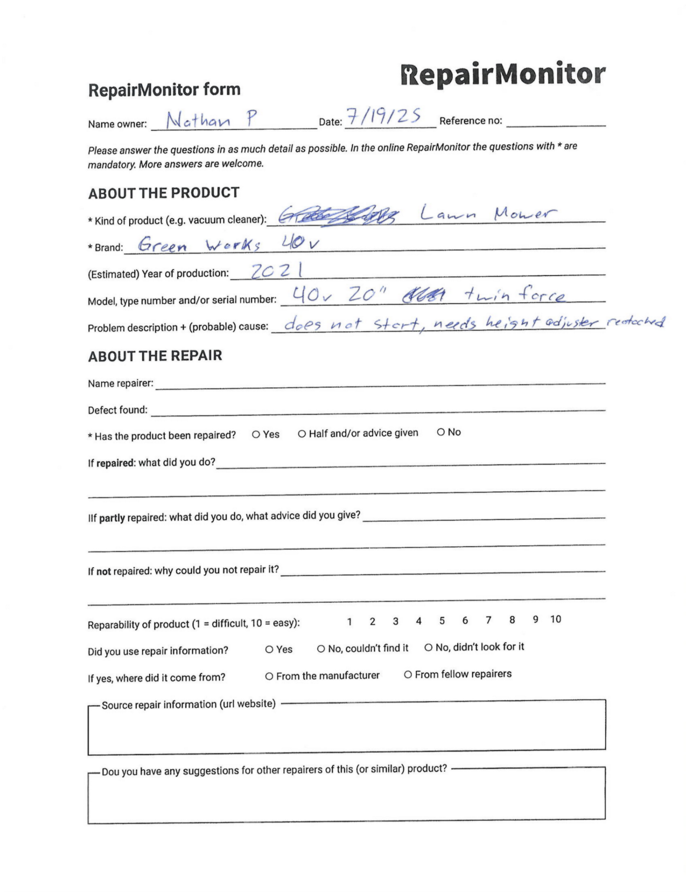
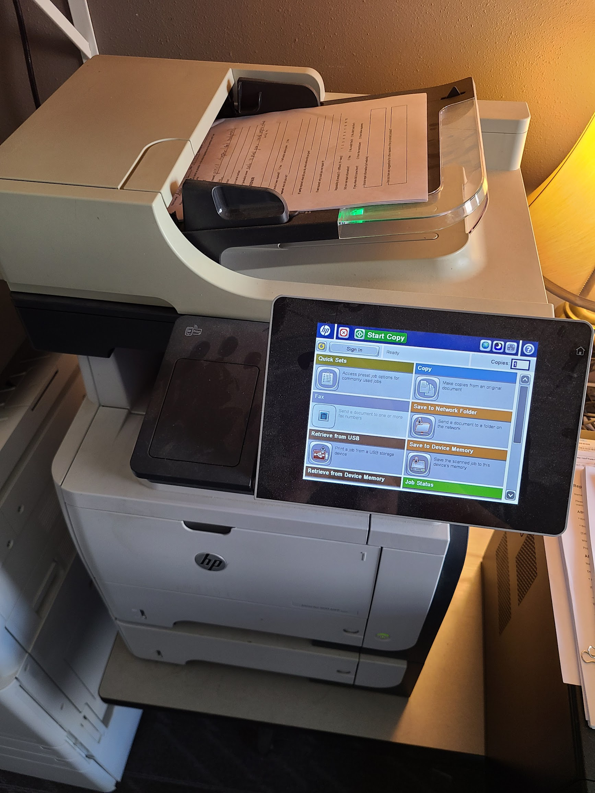

# Repair Cafe form processing

During every repair cafe patrons are given a form to document the nature of their object and the steps taken to repair it. We then take those forms, scan them, OCR them, and format the data. This script is what processes the output of the OCRing and converts it into CSV output.

Steps:
1) Use the desktop printer in the computer lab to scan repair cafe form. (Do not use the floor printer as it's owned by Kate, locked, and chargers her money for each use). This printer has the ability to scan directly to the chattlab NAS.

2) Use the AWS Textract service to perform OCR on the scanned files.

3) Run this script on the detectDocumentTextResponse.json files generated by AWS.
`./read_repair_textract.rb ocrs/detectDocumentTextResponse.json`

4) Copy the last lines of output (which are formatted as CSV) into a spreadsheet.